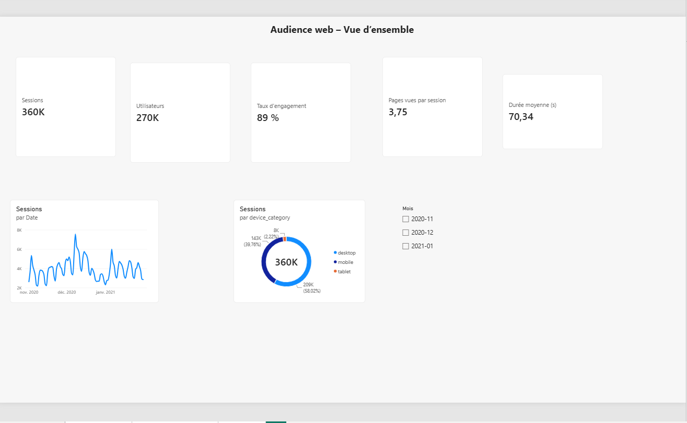
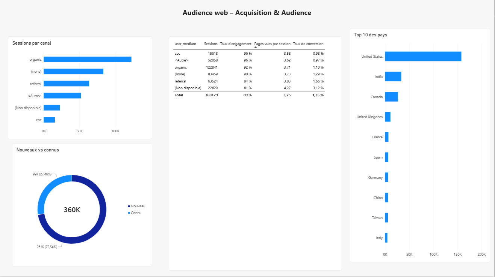
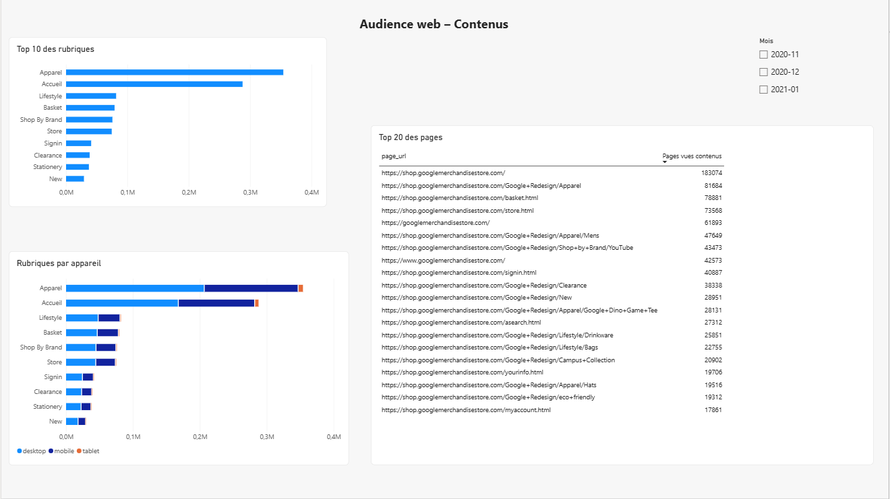

# Analyse d'audience web – Google Analytics 4 × Power BI

Projet personnel d'analyse de données web analytics : extraction de données GA4 brutes dans BigQuery (SQL), préparation et modélisation dans Power BI, restitution en tableau de bord de 3 pages.

## Contexte et objectif
Un site éditeur veut comprendre **qui vient, d'où, sur quels contenus et avec quel niveau d'engagement**, pour orienter sa stratégie éditoriale et ses investissements d'acquisition.

Questions métier traitées :
- Comment évoluent l'audience et l'engagement dans le temps ?
- Quels canaux d'acquisition apportent le plus de trafic, et le trafic le plus qualifié ?
- Quels contenus et rubriques génèrent le plus de pages vues ?
- Quelle part de l'audience est mobile, nouvelle ou fidèle ?

## Données
- **Source** : export GA4 public et anonymisé du Google Merchandise Store (`bigquery-public-data.ga4_obfuscated_sample_ecommerce`)
- **Période** : 1er novembre 2020 – 31 janvier 2021
- **Volume** : plusieurs millions d'événements bruts, agrégés en **360 129 sessions** et une table de pages vues

## Démarche
1. **Extraction (BigQuery / SQL)** – dépliage des paramètres d'événements (`UNNEST`), reconstitution des sessions à partir des événements, calcul de l'engagement, création de deux tables (`sessions`, `pages`) → [`ga4_extraction.sql`](ga4_extraction.sql)
2. **Connexion** – import des tables BigQuery dans Power BI via le connecteur Google BigQuery
3. **Préparation (Power Query)**
   - remplacement des valeurs masquées (`(data deleted)`, `<Other>`, `(not set)`)
   - **normalisation des URL** (casse, encodage des espaces `+`) avant extraction de la **rubrique** du site : une même section apparaissait sous plusieurs écritures
4. **Modélisation** – schéma en étoile : table Calendrier (marquée comme table de dates) reliée aux faits `sessions` et `pages`
5. **Mesures DAX** – sessions, utilisateurs, taux d'engagement, pages vues par session, durée d'engagement moyenne, taux de conversion, part de nouveaux visiteurs, évolution M-1
6. **Restitution** – 3 pages : Vue d'ensemble, Acquisition & Audience, Contenus, avec segment par mois synchronisé

## KPI suivis
| KPI | Définition |
|---|---|
| Sessions | Nombre de visites |
| Utilisateurs | Visiteurs uniques |
| Taux d'engagement | Sessions engagées / sessions (définition GA4) |
| Pages vues par session | Profondeur de visite |
| Durée d'engagement moyenne | Temps actif moyen par session |
| Taux de conversion | Sessions avec achat / sessions |

## Principaux enseignements
- **Audience** : environ 360 000 sessions et 270 000 utilisateurs sur 3 mois, avec 3,75 pages vues par session et environ 70 secondes d'engagement en moyenne.
- **Saisonnalité** : pic d'audience net début décembre, cohérent avec la période Black Friday / Cyber Monday et les achats de fin d'année.
- **Appareils** : le desktop reste majoritaire (58 % des sessions), le mobile représente 40 % et la tablette 2 %.
- **Acquisition** : le référencement naturel (organic) est le premier canal (34 % des sessions), devant l'accès direct (23 %) et les sites référents (18 %). Le payant (CPC) ne pèse que 4 % du trafic mais affiche l'un des meilleurs taux d'engagement.
- **Fidélisation** : 72,5 % des sessions proviennent de nouveaux visiteurs ; la fidélisation de l'audience est un levier de progression.
- **Géographie** : les États-Unis concentrent environ 44 % des sessions, suivis de l'Inde et du Canada.
- **Contenus** : la rubrique Apparel (vêtements) génère le plus de pages vues, devant la page d'accueil. Les pages panier et connexion figurent dans le top 10, signe qu'une part importante du trafic entre dans le tunnel d'achat.
- **Qualité des données** : la page d'accueil apparaît sous 3 domaines différents (`shop.`, `www.`, sans sous-domaine) ; une normalisation des URL est indispensable avant toute analyse de contenu.

## Captures

### Vue d'ensemble

### Acquisition & Audience

### Contenus

## Outils
BigQuery (SQL) · Power BI Desktop (Power Query, DAX, modélisation) · Google Analytics 4

## Limites
- Données anonymisées par Google : certaines valeurs sont masquées (`<Other>`, `(data deleted)`) et la cohérence interne est partielle. Le taux d'engagement (89 %) est probablement surestimé pour cette raison.
- La source et le support correspondent à l'acquisition du **premier contact** de l'utilisateur, pas de chaque session.
- Le site étudié est un site e-commerce ; la démarche (audience, acquisition, performance des contenus) est directement transposable à un site média.
